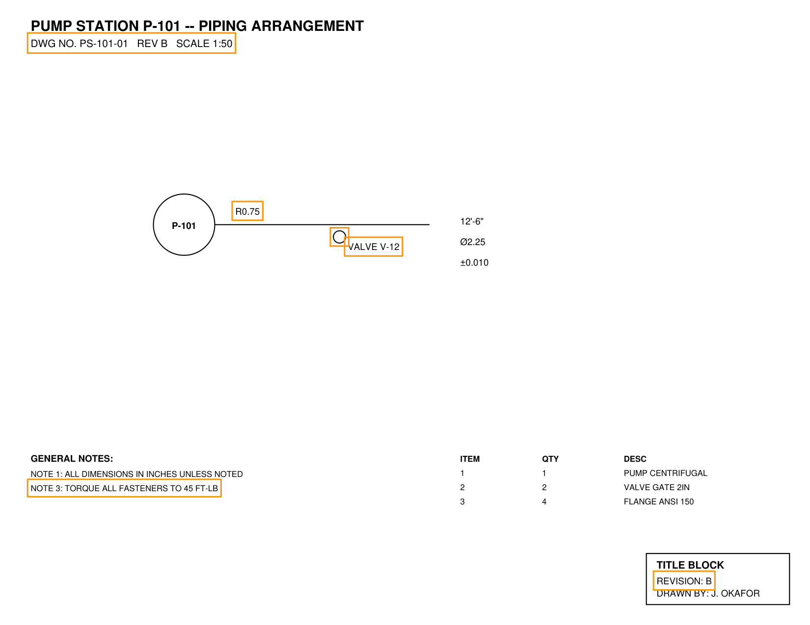

# Demo walkthrough

Run these from the repo root (after `make setup` and adding a real `ANTHROPIC_API_KEY`
to `.env` — see [README "Live verification status"](README.md#live-verification-status)
for what has and hasn't been confirmed against a real model response, and why).

## 1. Delta

```
$ make run PAIR=native_pdf
```

Produces `reports/native_pdf/delta.json` + `delta.md`. Six real changes detected between
`data/samples/native_pdf/A.pdf` and `B.pdf` (this step is fully verified, no LLM
involved):

```
[D-001] Note changed: 'DWG NO. PS-101-01   REV A   SCALE 1:50' → '...REV B...'
[D-002] Text 'VALVE V-12' moved
[D-003] Geometry '(unlabeled element)' moved
[D-004] Text changed: 'REVISION: A' → 'REVISION: B'
[D-005] Dimension changed: R0.50 → R0.75
[D-006] Note changed: 'NOTE 2: FIELD VERIFY...' → 'NOTE 3: TORQUE ALL FASTENERS...'
```

(D-006 is the documented aligner limitation described in the README — the eval harness
catches it and scores it as a miss + an unexplained item, rather than the system
silently getting it wrong unnoticed.)

Bonus markup: `make markup PAIR=native_pdf` draws these six changes back onto Rev B as
colored boxes (`reports/native_pdf/markup_B.pdf`) — verified visually, screenshot below.



## 2. Grounded chat

```
$ make chat PAIR=native_pdf
Ingesting A.pdf + B.pdf and computing delta...
Delta report: reports/native_pdf/delta.md (6 changes)
Grounded chat ready. Ask about either revision or what changed. Ctrl-D to exit.

> Did any dimensions change near the pump?
```

**What actually happened when this was run:** retrieval executed correctly and pulled
the right context — including `D-005` (`R0.50 → R0.75`), confirmed directly via
`RetrievalIndex.search()` in `tests/test_retrieval_index.py` — but the subsequent
Anthropic API call was rejected with `400: Your credit balance is too low`. No live model
response has been observed. The full request/failure is captured, uncut, in
[`docs/example_trace_chat_turn_api_error.json`](docs/example_trace_chat_turn_api_error.json):
retrieval span `status: "ok"`, LLM span `status: "error"` with the exact API error and a
stack trace, both correlated by `trace_id`.

To complete this step: fund the key in `.env` and re-run the command above.

## 3. Eval scorecard

```
$ make eval-no-llm
```

This ran for real — see the README "Delta results" table (dxf and scanned_pdf: 1.00 F1;
native_pdf: 0.77 F1 with the known aligner limitation surfaced in the candid failure
table, not hidden).

`make eval` (adds chat correctness/groundedness scoring via LLM-judge) hits the same
API-credit blocker as step 2 above and has not produced a live scorecard.
